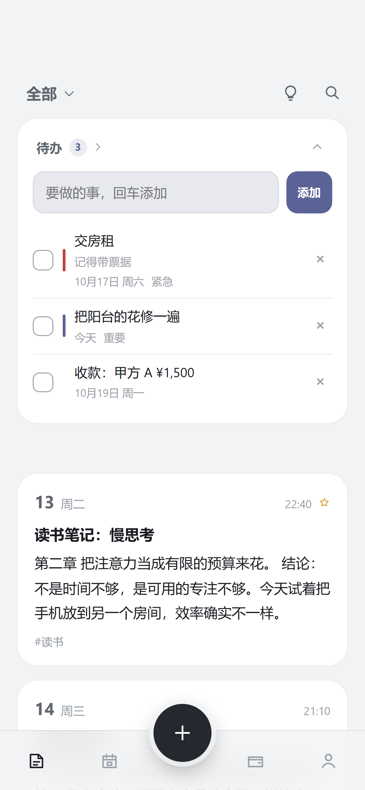
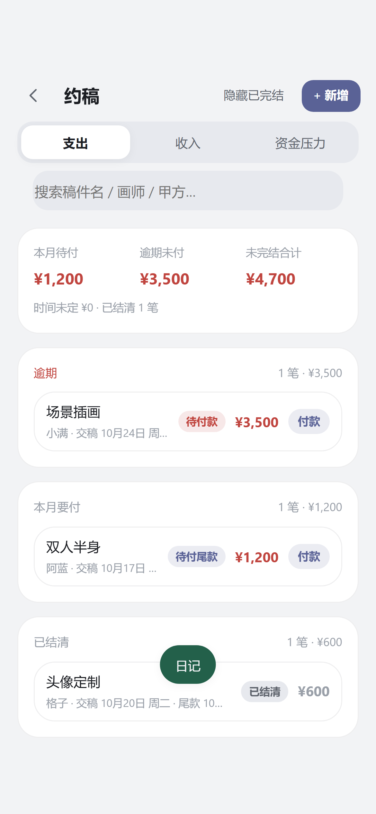
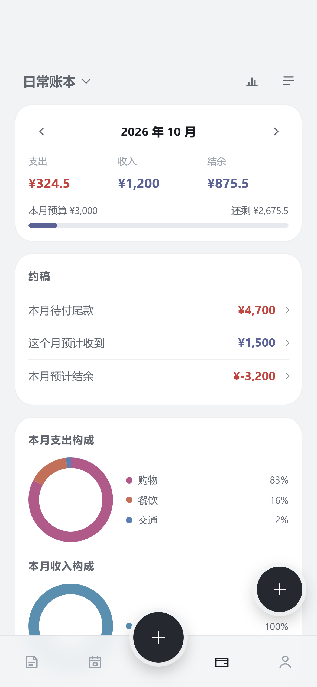
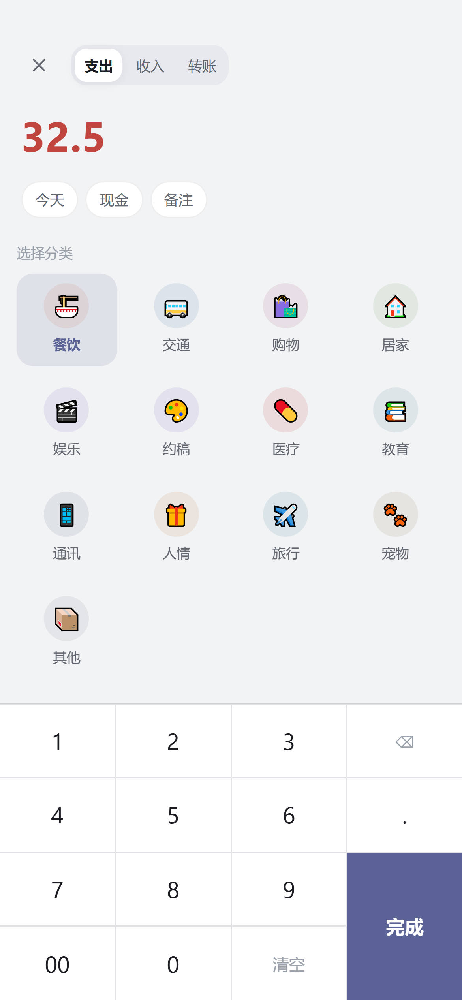
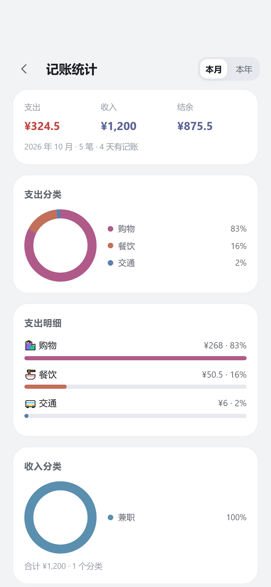
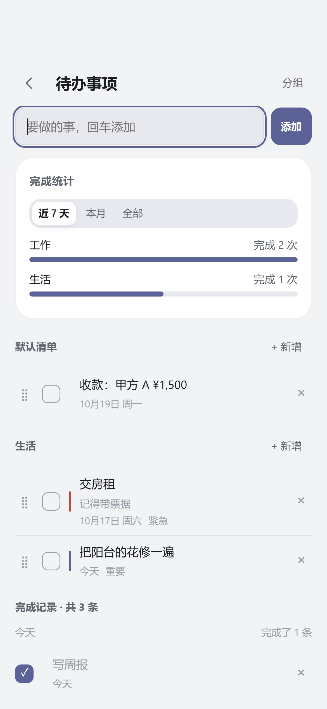
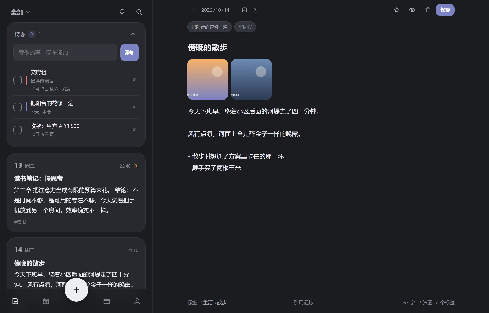

# 拾光日记

日记、记账、待办三合一的本地应用。零框架、零构建、零依赖，双击 `index.html` 就能用；手机端是「卡片时间线 + 日历 + 底部导航」的紧凑布局，可以装到主屏当 App 用（PWA），也能用 Capacitor 打包成 Android / iOS 原生应用。

所有内容只存在你自己的设备上，不联网、不上传。

<p align="center">
  
  
  
</p>

<p align="center">
  
  
  
</p>



## 三个模块

### 日记

- 写完就走：输入停下 500ms 自动保存，没有「保存」按钮
- 时间线：大圆角卡片，每张卡片自带「26 周六」日期头、时间、标签、图片缩略图
- 日历：周一开始的月历，写过日记的日子有圆角底纹、今天是高亮块
- 全文搜索：标题、正文、标签一起搜；按全部 / 今天 / 最近 7 天 / 收藏 / 有图片 + 标签筛选
- 上/下一篇：编辑器里用 ‹ › 或左右滑动翻页
- Markdown：加粗、斜体、标题、列表、引用、行内代码、链接，带实时预览；所有内容先转义再渲染，不会执行脚本
- **引用记账**：编辑器底部点「引用记账」，从最近 30 笔里挑一条，就会在光标处插入一行引用（如 `> 09-26 21:10 餐饮 ¥25 · 楼下的小面馆`）
- 图片：支持查看日记里的图片
- 备份：导出 JSON / Markdown / **完整备份 ZIP（含图片）**，导入加密 `.mbk` / ZIP / JSON / 文本
- 统计（在「我的 → 日记统计」）：篇数 / 天数 / 连续记录 / 字数 / 图片数，13 周热力图 + 最近 6 个月柱状图

### 记账

对标主流记账 App 的完整账本：

- 一笔一条：支出 / 收入 / 转账，带日期、时间、分类、账户、备注
- **记一笔是全屏金额键盘 + 分类九宫格**：点右下角「＋」→ 敲金额 → 选分类 → 完成；顶部三个小胶囊能改日期、**换账户**（会记住上次用的那个）、写备注
- 分类：支出 12 类、收入 8 类预置，可新增 / 改名 / 换图标与颜色
- 账户：现金 / 储蓄卡 / 信用卡 / 虚拟账户 / 其他，可设初始余额（信用卡欠款填负数），支持账户间转账
- 预算：每月总预算 + 分类预算，首页进度条显示已用 / 剩余，超支变红
- 周期记账：房租、工资这类固定收支，规则建好后自动补上到期的那几笔（幂等，不会重复记）
- 多账本：生活 / 工作分开记，流水、分类、账户、预算、周期规则都按账本隔离
- 统计：本月 / 本年切换，**支出构成与收入构成两份环形图 + 明细条**、最近 6 个月收支双色柱状、账户余额
- 记账首页也直接给出**本月支出构成 + 本月收入构成**两个环形图，一眼看出钱从哪来、花到哪去
- 导出：记账可单独导出 CSV（Excel 直接打开），完整备份也会带上记账数据

### 约稿（约稿支出 / 待收款项 / 资金压力）

记账页里有一张「约稿」卡，点进去是三个视图：

- **支出**：一笔约稿一条订单（稿件名 / 画师 / 总价 / 已付 / 稿件截止日 / 尾款约定时间），自动派生「待付款 / 待付尾款 / 已结清」×「绘制中 / 已完稿」，按「逾期 / 本月 / 以后各月 / 时间未定 / 已结清」分组。行上点「付款」填本次金额，会自动记一笔支出流水（分类默认「约稿」）并累加已付，付满就是已结清。
- **收入**：待收款项（甲方欠你的钱），记甲方、稿件、应收金额、已收与约定到账日。**约定到账日可以留空** —— 那部分就是「不知道什么时候能收到」的钱，单独归到「时间未定」。行上点「收款」会自动记一笔收入流水，底部还有「按甲方看」的欠款汇总。
- 待收款项**填了约定到账日就会自动生成一条待办**（文案带甲方与金额、日期跟着到账日走），到那天提醒你催款；改了日期跟着改，收齐自动完成，删掉待收就连带删掉。
- **资金压力**：填预计工资、其他收入、其他固定支出，本月待付尾款自动带入（可以改），实时算出「本月预计结余 = 收入 − 固定支出 − 尾款」，超支变红并告诉你还差多少。

### 待办

- 时间线页顶部有小卡片，回车就能加一条；点标题进二级页
- **回车加的就是今天的待办**，要改日期或加具体时间（如 14:30）点进编辑；优先级（普通 / 重要 / 紧急）、备注、自定义分组、拖拽排序
- 待办卡片右上角有个小箭头，点一下**收起成一行**（只留「待办 · N 条未完成」），再点展开；状态会被记住
- **勾完就从列表消失，但历史不丢**：已完成的会留在日历当天的详情里，二级页也按「完成那天」分组归档，并给出**完成统计**（近 7 天 / 本月 / 全部，按分组显示完成次数与进度条）
- **和日历打通**：待办模式的格子里显示 `未完成/总数`（如 `3/5`，全部做完会变淡），逾期标红；打开当天的日记时，顶部也会列出这天的待办，点一下就能勾

### 日历的四种查看模式

**右上角一颗按钮**，点一下就换一档（每次切换会弹一个绿色小气泡告诉你现在是哪个模式），顺序固定：

- **日记**：有记录的日子带底纹
- **记账**：格子里直接显示当天支出金额（超过一千缩写成 `1.2k`），有收入的日子右上角有一个小圆点
- **待办**：格子里显示当天还没完成的条数，逾期标红
- **排单**：格子里两行分开显示——靛蓝是当天要交的稿件数量（拖期未完稿标红），**浅红是当天有几笔待收到账**；点进去分别列出「要交的稿」和「预计收到」的金额明细

记账模式除了当天的实际支出，还会用**浅色小方块**标出那天要付的约稿尾款，详情区固定显示一行「本月尾款预支出」（含逾期未付的，并注明逾期金额）。日历下方的详情区顶部还有一个常驻的小加号，按当前模式在当前选中的日期直接新建（日记 / 记一笔 / 待办 / 约稿）。

点某一天，下面的详情也跟着模式变；切换会被记住。想换年月，点左上角的日期就行；「回到今天」在右边。

## 快速开始

直接用浏览器打开 `index.html` 就能写。想要离线缓存、装到主屏，就用本地服务器：

```bash
npm start          # 默认 http://localhost:5173
npm start -- 8080  # 换端口
```

### 装到手机上

PWA 需要 HTTPS 或 localhost：

1. **同一 Wi-Fi 下试玩**：电脑执行 `npm start`，终端会打印局域网地址（形如 `http://192.168.x.x:5173`），手机浏览器打开后用菜单里的「添加到主屏幕 / 安装应用」。
2. **正式使用**：把运行时要用的文件（`index.html`、`css/`、`js/`、`icons/`、`manifest.webmanifest`、`sw.js`）丢到任意 HTTPS 静态托管，手机访问后添加到主屏即可，断网也能用。

Android 上还可以用桌面快捷方式：长按图标 →「写日记」直接进入编辑器。

## 导入备份

「我的 → 导入备份…」里选择文件即可，会自动识别格式：

| 文件 | 说明 |
| --- | --- |
| `.mbk` | WinZip AES-256 加密的 ZIP 备份，里面每条日记一个正文条目 ＋ 若干张图片；正文、时间、标签、图片都会还原 |
| `.zip` | 本应用导出的完整备份，或任何内含 `entries.json` 的 ZIP |
| `.json` | 本应用导出的 JSON，或常见字段名的日记 JSON（支持 `content/text/body/正文`、`date/createTime/日期`、`tags/标签` 等别名） |
| `.txt` / `.md` / `.html` | 直接当成一篇日记导入 |

加密备份的默认口令是 **`timenotes`**。导入时**留空会自动尝试默认口令**，也可以用更早的历史口令；两把都不对才需要你手动填。

导入时可以选择「合并」（保留现有日记，按 id 比对，保留更新时间较新的）或「覆盖」（清空后写入）。图片可以一起导入，也可以先关掉只导文字。

> 完整备份 ZIP 和 JSON（v3）都会带上记账、待办、账本、分类、账户、预算与周期规则，换设备时一起搬过去。

## 打包成原生 App（Capacitor）

需要 Node 18+，Android 需要 Android Studio，iOS 需要 macOS + Xcode。**首次安装依赖需要联网。**

```bash
npm install --save-dev @capacitor/cli
npm install @capacitor/core @capacitor/android      # iOS 换成 @capacitor/ios
npm run build:native                                # 生成 www/
npx cap add android
node tools/setup-android.mjs                        # 换应用图标 + 配国内 Gradle 镜像（国内必做）
npx cap sync android
npx cap open android                                # Android Studio → Build → Build APK(s)
```

以后每次改完前端代码：`npm run build:native && npx cap sync`。

几个容易踩的点：

- **必须用 Android Studio 打开 `android/` 目录**（不是项目根目录）。
- 重新执行过 `npx cap add android`（比如换了电脑）之后，要再跑一次 `node tools/setup-android.mjs`。
- Gradle 分发和依赖仓库已被 `setup-android.mjs` 换成腾讯 / 阿里云镜像，国内才能拉得动。
- 改了 `js/` 里的任何东西，**必须 `npm run build:native` 才会进包**——`www/` 才是被打进 APK 的那一份。
- 自己日常用，`Build → Build APK(s)` 出的 debug 包就够；要发布到应用商店才需要签名。
- **项目路径不要有中文和空格**，AGP 对路径很敏感。
- 命令行构建要用与 Gradle 兼容的 JDK（Android Studio 自带的 JBR 一般最稳）。
- Capacitor 原生包里不注册 Service Worker（文件本来就在包内），`js/main.js` 里已做判断。

## 键盘快捷键

| 快捷键 | 作用 |
| --- | --- |
| `Ctrl/Cmd + N` | 新建日记 |
| `Ctrl/Cmd + S` | 立刻保存（平时不用按） |
| `Ctrl/Cmd + K` | 打开搜索 |
| `Ctrl/Cmd + P` | 打印 / 存成 PDF（打印的是当前这篇的排版版） |
| `Esc` | 关掉弹层、收起金额键盘，或从编辑器返回列表 |

## 数据与隐私

- 数据保存在设备本地数据库（IndexedDB）里，**不会**发送到任何服务器；IndexedDB 不可用时会自动降级到 localStorage，再退到内存并给出提示。
- 「我的 → 备份与迁移」里可以导出完整备份（v3，含记账与待办）、JSON、Markdown 和记账 CSV。
- **导出再导入（覆盖）不会丢东西**：日记的具体时间、记账、待办、约稿、分类、账户、预算、周期规则都会原样还原；导入一份只有日记的备份也不会把现有账本清空。
- **手机上导出真的会出文件**：原生 App 里 WebView 不支持网页式下载，所以导出会先把文件写进应用缓存再**调起系统分享面板**，你选「保存到文件 / 发给微信 / 发到自己邮箱」都行；在电脑浏览器里还是直接下载。
- 注意：清理浏览器数据、换设备、卸载 App 都会带走数据，请定期导出备份。

## 项目结构

```
index.html                 单页界面，含首屏主题注入
css/style.css              全部样式（CSS 变量控制明暗主题）
js/aes.js                  小 AES（解密 WinZip AES 需要小端 CTR，WebCrypto 做不到）
js/model.js                纯逻辑：日期、日历、标签、筛选排序、统计、Markdown、记账 / 待办 / 约稿的领域规则
js/db.js                   存储适配层：IndexedDB → localStorage → 内存 三级降级
js/zip.js                  ZIP 读写：中央目录、deflate、WinZip AES、打包完整备份
js/importer.js             备份导入：.mbk / zip / json / 文本 自动识别与字段映射
js/store.js                数据仓库：日记、记账（账本 / 分类 / 账户 / 预算 / 周期）、待办、约稿（订单 / 待收款项）
js/settings.js             界面偏好（主题 / 字号 / 上次打开 / 当前页签 / 日历模式 / 当前账本 / 资金压力估算值）
js/ui.js                   图标、DOM 小工具、轻提示
js/app.js                  界面控制器：时间线、日历四态、记账键盘、待办、约稿专区、编辑器、导入导出
js/main.js                 入口（含启动失败提示与原生返回键）
sw.js                      Service Worker：应用外壳缓存，离线可用
manifest.webmanifest       PWA 清单（可安装、含桌面快捷方式）
icons/                     图标（SVG + 各尺寸 PNG）
tools/                     开发脚本（服务器、测试、冒烟、截图、图标、打包、测试夹具）
tests/                     单元测试
capacitor.config.json      原生打包配置
```

## 开发脚本

| 命令 | 作用 |
| --- | --- |
| `npm start` | 本地静态服务器（默认 5173，可 `npm start -- 8080`） |
| `npm test` | 单元测试（逻辑层、仓库层、AES/ZIP、导入识别、记账与待办） |
| `npm run smoke` | 端到端冒烟测试：真实浏览器跑「新建 → 自动保存 → 刷新 → 日历三态 → 记一笔 → 待办 → 导入 → 删除 → file:// 双击打开」 |
| `npm run screenshots` | 生成 `screenshots/` 里的预览图 |
| `npm run icons` | 重新生成各尺寸图标（图形定义在 `tools/make-icons.mjs`） |
| `npm run build:native` | 生成 `www/` 供 Capacitor 使用 |

`npm run smoke` 和 `npm run screenshots` 需要本机有 Chrome 或 Edge，找不到会自动跳过；也可以用 `DIARY_BROWSER=/path/to/chrome` 指定。

## 设计与取舍

- **无构建步骤**：直接写经典脚本，浏览器能跑的内容就是最终产物。改一行文案刷新即可。
- **为什么不用 ES Module**：`<script type="module">` 在 `file://` 下会被浏览器以 CORS 拦掉，导致双击打开后「按钮全都没反应」。改成经典脚本 + `Diary` 命名空间后，双击打开也能正常使用。
- **不做云同步**：日记和账目是很私密的东西，默认只留在本地。需要多设备就用导出/导入。
- **全量载入内存**：个人量级下（几千篇 / 几千笔）筛选排序都是毫秒级，换来的是逻辑简单。
- **AES 自己实现**：WebCrypto 的 AES-CTR 只按大端递增计数器，而 WinZip AES / Zip4j 用的是小端计数器，也没有 ECB 可以自己搭 CTR，所以带了一个 100 多行、可用 FIPS-197 标准向量验证的小 AES。
- **记账不引入图表库**：环形图、柱状图、进度条都是手写的内联 SVG / CSS，保持零依赖。

## 已知限制

- 日记正文不做加密上锁（`.mbk` 是加密备份，导入后存在本地是明文）。
- 数据不跨设备自动同步。
- 记账目前不支持导入第三方账单（微信 / 支付宝 CSV），只能导出。
- 界面里只能**查看**导入的图片，还不能在 App 内新增图片；图片会随「完整备份 ZIP」一起导出。
- 列表是整表渲染，条目数到数万级时可能需要改成分页或虚拟滚动。
